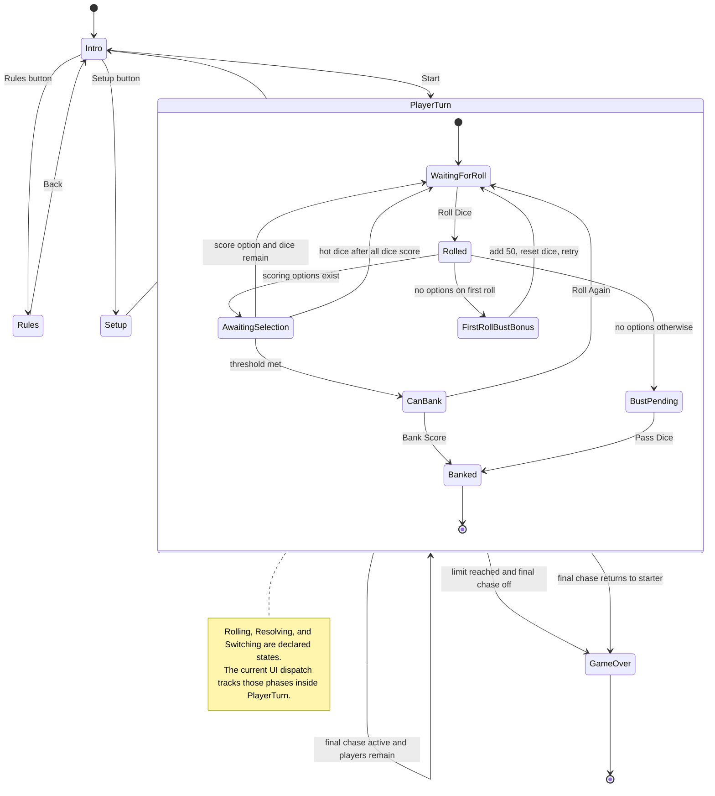
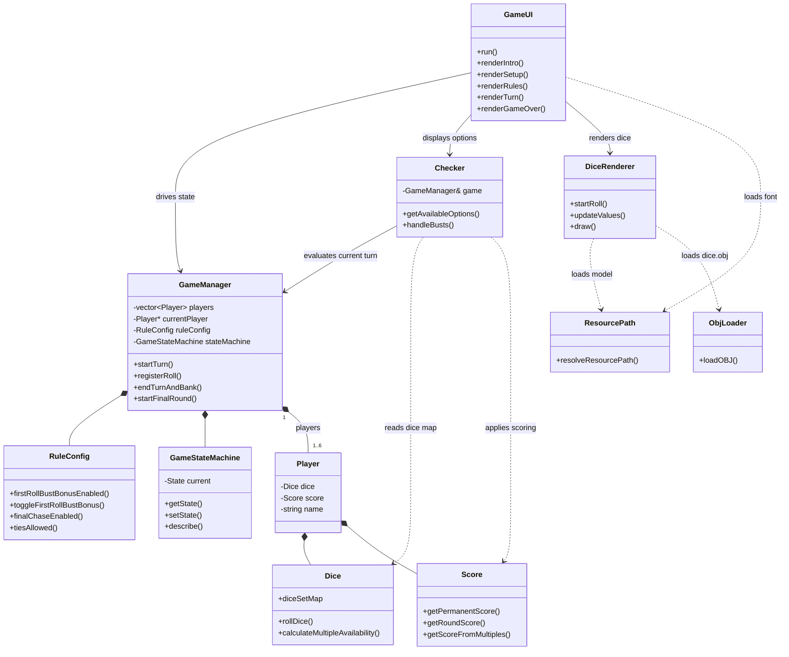

# Zilch
This branch is the SFML/OpenGL visual interface version of Zilch.

The audited CLI version is preserved on the `zilch-cli` branch.

Prerequisites on macOS:
- `brew install sfml@2 libomp`

Build and run:
- `cmake -S . -B build`
- `cmake --build build`
- `./build/Zilch`

Or use:
- `make`

Architecture:

First-roll bust behavior:
- When enabled, a first roll with no scoring options awards 50 round points, resets to all six dice, clears the rolled/selected flags, and lets the same player roll again.
- The bonus is tracked per turn and can only be used once; any later bust clears unbanked round points and requires passing dice.
- The behavior is covered by `ZilchRulesTests` through the `firstRollBustBonusIsOneTimeAndRestartsRoll`, `disabledBustBonusBustsImmediately`, and `nonBustHandsDoNotTriggerBustHandling` cases.

Run tests:
- `ctest --test-dir build --output-on-failure`
- `make test`

The `ZilchRulesTests` target covers core dice invariants, scoring combinations, rule toggles, bust handling, banking gates, final-round and winner state, state-machine descriptions, and resource path resolution.
