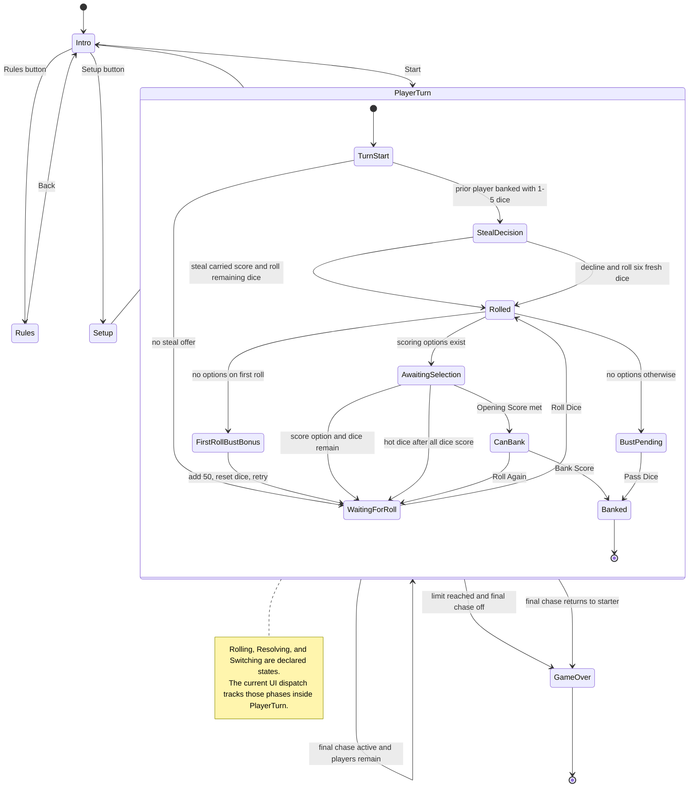
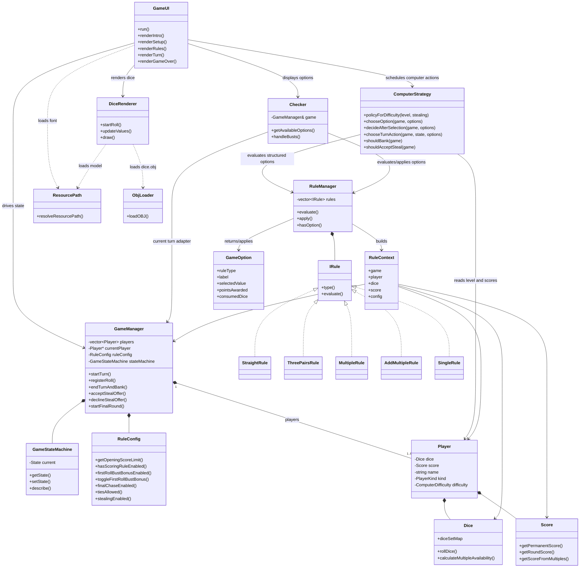

# Zilch
This branch is the SFML/OpenGL visual interface version of Zilch.

The audited CLI version is preserved on the `zilch-cli` branch.

The current implementation keeps the SFML surface while aligning its rule and
option layer with the other Zilch projects: `Checker` is an adapter over
`RuleManager`, `IRule`, `RuleContext`, and `GameOption`.

Prerequisites on macOS:
- `brew install sfml@2 libomp`

Build and run:
- `cmake -S . -B build`
- `cmake --build build`
- `./build/Zilch`

Or use:
- `make`

## Shared gameplay baseline

- Two players and a winning score of 5000.
- Opening Score of 1000.
- Straight, Three Pairs, Multiples and extensions, and Singles enabled.
- One 50-point First-Roll Bust recovery enabled.
- Final Chase and Allow Ties enabled.
- Stealing disabled.

At least one scoring rule must remain enabled before a game can start. The
legacy Bank Threshold API remains available as a compatibility alias for
Opening Score. Opening Score is always capped at the configured Winning Score.

## Players and computer levels

This edition remains the native SFML/OpenGL presentation of Zilch. It supports
one to six named player slots, and every slot remains Human by default for the
original pass-and-play experience. On the Setup screen, click a player's
controller label to cycle through Human, Easy, Medium, Hard, and back to Human.
Computer actions are paced and wait for the existing dice animation rather than
skipping the visual turn.

- Easy scores every available scoring die, banks at about 600 round points once
  banking is legal, and always banks a reachable winning score.
- Medium also clears the available scoring dice, then adjusts its risk near the
  finish. It seeks a buffer when a close opponent will receive a Final Chase,
  may bank just short of the Winning Score when it already has a safe lead, and
  keeps rolling when it still needs to catch the Final Chase leader.
- Hard chooses scoring combinations and bank timing with the tested policy
  from Computers vs Zilch. When Stealing is enabled it switches the
  complete policy, including steal acceptance, rather than reusing the standard
  game's dice values.

The embedded standard Hard policy uses bank thresholds of
`200, 1021, 1128, 1506, 2130, 5000` for ordinary decisions with one through six
dice. On a roll with an available multiple or an already saved chain, it plans
the scoring selections and bank-or-roll action together. Each legal branch is
scored by the real `RuleManager`; its next-roll score and bust probability are
enumerated exactly. The chain cutoff uses the frozen weight-one symmetric
blend, then the existing opponent and endgame adjustments. Unclaimed scoring
dice are included in alternative bank paths, so their value is not subtracted
twice. For example, a low-risk `6,6,6,5,2,3` roll keeps just the sixes and rolls
three dice, while more points at risk can justify taking the five and banking.

Outside multiple rolls, the existing greedy selection and collect-before-bank
behavior remain in place. A guaranteed outright win is protected even if
collecting another single is necessary. The selected plan is private to the
game, survives hot dice and the UI's waiting-for-roll transition, and clears
when a roll or turn actually begins or ends. The ordinary six-dice decision
remains more willing to roll:
with both banked totals at zero, it rolls again at 2,800 turn points. Existing
opening and opponent-aware endgame decisions still take priority over cutoffs.

Its utility values
are score `1.0045`, remaining dice `36.0805`, hot dice `354.561`, multiple
`91.9329`, lead `0`, trail `0.293194`, closing `0.193316`, and roll bias
`136.066`. Threshold adjustments retain full fractional precision, matching
the web game and headless simulator.

The preceding hot-dice refinement earned 51.5992% of match points against its previous actual Hard
bot in a separate 500,000-game, seat-mirrored holdout (seed `1500000000`).
The 95% paired interval was 51.5289% to 51.6695%. Reproducible
candidate, tuning, and holdout records live in the
[web project's research folder](https://github.com/anderson-webops/zilch.jacobdanderson.net/tree/main/docs/research/hot-dice-2026-09).

The new chain-scoped policy earned 51.4544% of match points against that
hot-dice-refined Hard in a fresh 500,000-game mirrored holdout. Its 95% paired
interval was 51.3338% to 51.5750%. This is a tested improvement, not proof of
optimal play or a result for every rule variant. The multiple-selection study
and candidate provenance are retained in the
[web research records](https://github.com/anderson-webops/zilch.jacobdanderson.net/tree/main/docs/research/multiple-selection-2026-09).

Saved multiples extend with every matching die, including three matching dice
at once. A saved 600-point six chain plus three sixes adds 4,200 points. Scoring
all remaining dice clears that saved chain immediately, before another roll.
Look-ahead copies rebind the active-player pointer to their own player storage,
so evaluation never scores or removes dice from the live game.

Stealing retains its separate policy and does not enable this new
collect-before-bank behavior. Its Hard policy uses thresholds
`313, 313, 1106, 1360, 1360, 1376` and utility values score `0.88553`, remaining
dice `91.2663`, hot dice `229.628`, multiple `94.2546`, lead `0`, trail
`0.187935`, closing `0.20764`, and roll bias `-26.2974`. Its practical minimum
steal offers are about 550, 450, 350, 250, and 150 points with one through five
dice left. In a 500,000-game holdout (seed `2026091102`), it earned 52.053% of
match points against the baseline policy. The same policy earned 51.706% with
Three Pairs disabled in a separate 500,000-game holdout (seed `2026091104`).
These are play policies only; large training and arena runs remain in the
computer-focused project.

## Architecture





First-roll bust behavior:
- When enabled, a first roll with no scoring options awards 50 round points, resets to all six dice, clears the rolled/selected flags, and lets the same player roll again.
- The bonus is tracked per turn and can only be used once; any later bust clears unbanked round points and requires passing dice.
- The behavior is covered by `ZilchRulesTests` through the `firstRollBustBonusIsOneTimeAndRestartsRoll`, `disabledBustBonusBustsImmediately`, and `nonBustHandsDoNotTriggerBustHandling` cases.

Stealing behavior:
- Stealing is an optional setup toggle and is disabled by default.
- When a player banks with one to five dice unrolled, the immediately following player may roll those dice and copy the completed round score as the start of a continuation. The prior player keeps the score they banked.
- The offer is available only to a player whose permanent score already meets the configured Opening Score, so stealing cannot put a player on the board.
- A successful continuation can be banked and offered again with its larger carried score. Choosing a fresh six-die roll, busting, or scoring all available dice ends the chain.
- A bust during a steal loses the carried score and is not rescued by the optional first-roll bust bonus.

Run tests:
- `ctest --test-dir build --output-on-failure`
- `make test`

The `ZilchRulesTests` target covers core dice invariants, structured rule options, scoring combinations, rule toggles, bust handling, banking and stealing gates, steal chaining and termination, final-round and winner state, state-machine descriptions, resource path resolution, mixed human/computer setup, exact policy constants and threshold rounding, scoring selection, computer action planning, opponent-aware finish decisions, and Stealing-specific acceptance thresholds.

`ZilchChainStrategyTests` covers points-at-risk, multiple value, opponent
position, opening requirements, strict final wins, three-die extensions,
hot-dice planning, non-chain fallback, isolated copy construction/assignment,
and intent resets at every roll/turn boundary.

### Cross-implementation decision probe

`ZilchDecisionProbe` accepts newline-separated checkpoints on standard input
and emits one JSON object per line. It uses the production Hard policy and the
actual paced action planner, without opening a window or rolling random dice.
The 12 whitespace-separated fields match the headless probe:

```text
turnScore ownScore opponentScore target opening stealing finalChase finalChaseActive ties sets diceCsv savedScoresCsv
0 0 0 5000 1000 0 1 0 1 1 6,6,6,5,2,3 0,0,0,0,0,0
```

Boolean fields accept `0`/`1` or `false`/`true`. The six saved scores are ordered
by face; at most one may be nonzero, as two simultaneous saved chains are not
reachable before all six dice reset. Output fields are `line`,
`selected_counts`, `action`, `score_gain`, `projected_turn_score`, `next_dice`,
and `can_bank`. `--self-test` is also part of CTest. Build in a fresh temporary
directory outside the Dropbox checkout to keep generated files separate.
