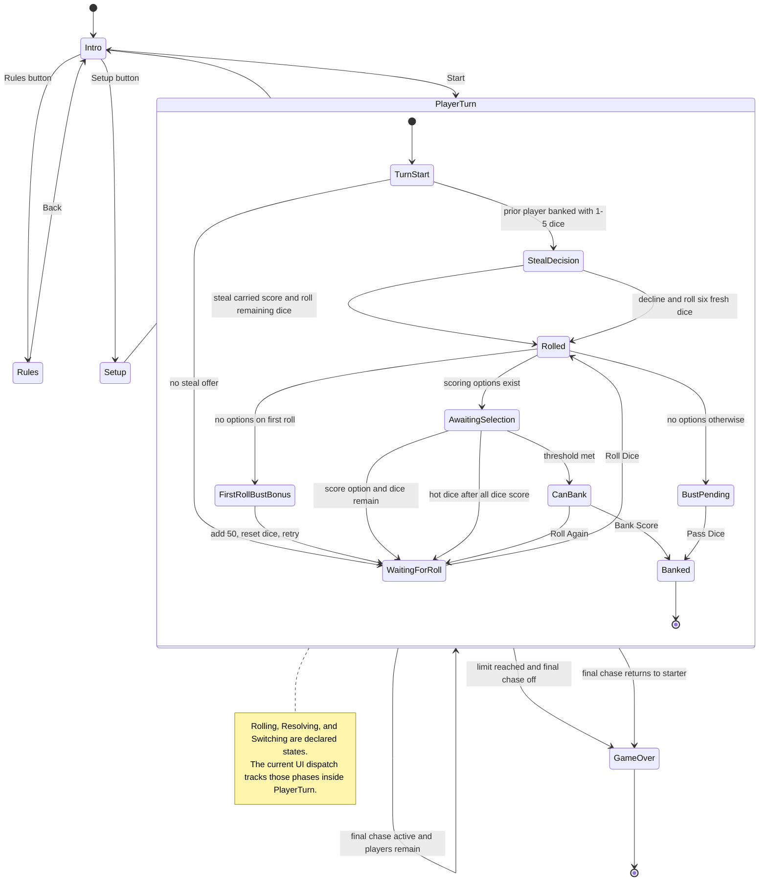
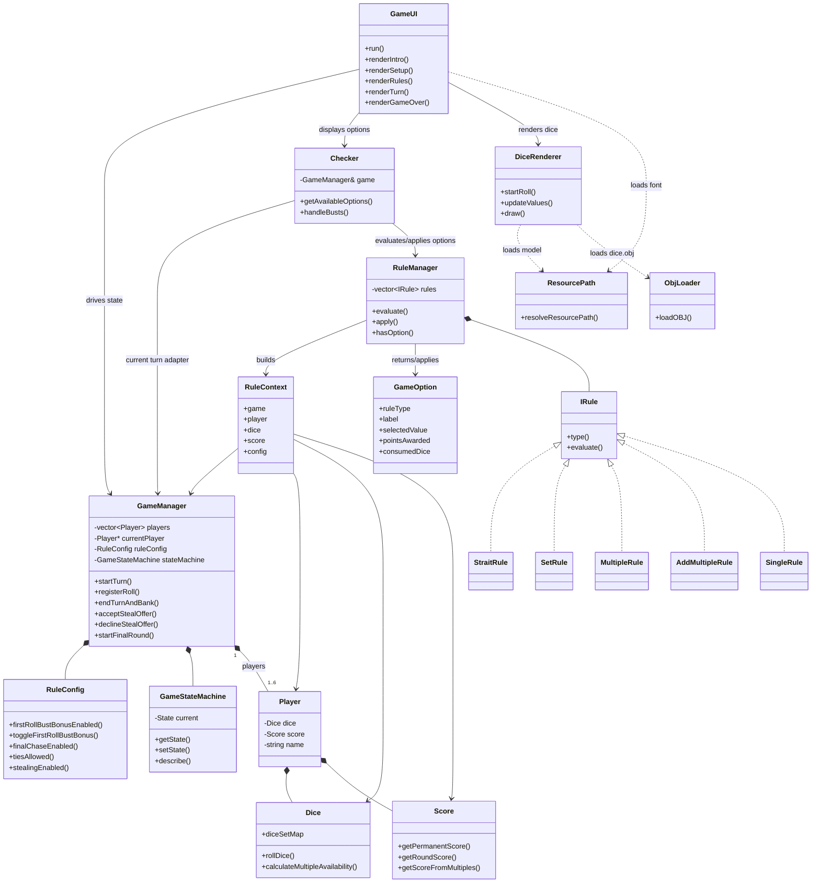

# Zilch
This branch is the SFML/OpenGL visual interface version of Zilch.

The audited CLI version is preserved on the `zilch-cli` branch.

The `dev/architecture/zilch-basic-structure` branch keeps the SFML surface but
pulls the rule/option layer toward the Java `Zilch Basic` structure: `Checker`
is now an adapter over `RuleManager`, `IRule`, `RuleContext`, and `GameOption`.

Prerequisites on macOS:
- `brew install sfml@2 libomp`

Build and run:
- `cmake -S . -B build`
- `cmake --build build`
- `./build/Zilch`

Or use:
- `make`

Architecture:

First-roll bust behavior:
- When enabled, a first roll with no scoring options awards 50 round points, resets to all six dice, clears the rolled/selected flags, and lets the same player roll again.
- The bonus is tracked per turn and can only be used once; any later bust clears unbanked round points and requires passing dice.
- The behavior is covered by `ZilchRulesTests` through the `firstRollBustBonusIsOneTimeAndRestartsRoll`, `disabledBustBonusBustsImmediately`, and `nonBustHandsDoNotTriggerBustHandling` cases.

Stealing behavior:
- Stealing is an optional setup toggle and is disabled by default.
- When a player banks with one to five dice unrolled, the immediately following player may roll those dice and copy the completed round score as the start of a continuation. The prior player keeps the score they banked.
- The offer is available only to a player whose permanent score already meets the configured bank threshold, so stealing cannot put a player on the board.
- A successful continuation can be banked and offered again with its larger carried score. Choosing a fresh six-die roll, busting, or scoring all available dice ends the chain.
- A bust during a steal loses the carried score and is not rescued by the optional first-roll bust bonus.

Run tests:
- `ctest --test-dir build --output-on-failure`
- `make test`

The `ZilchRulesTests` target covers core dice invariants, structured rule options, scoring combinations, rule toggles, bust handling, banking and stealing gates, steal chaining and termination, final-round and winner state, state-machine descriptions, and resource path resolution.
